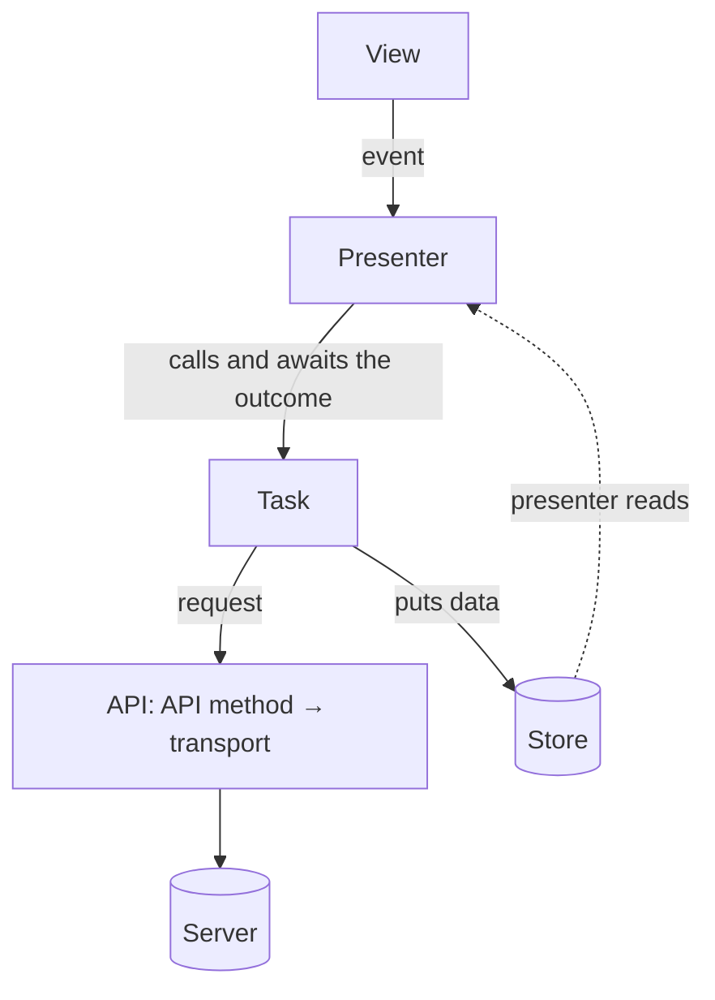

# Simple Architecture — core

Universal rules: no screens, data or libraries of any one project. Three levels of rules:

- **Core** — `sa-*.md`: true for any project. This file is always loaded; each layer's file loads
  with that layer's files (`sa-view`, `sa-presenter`, `sa-task`, `sa-store`, `sa-api`).
- **Platform** — `platform-*.md`: true for any project on that platform (web, own server).
- **Project** — the project section of `CLAUDE.md`: which library, folder, alias or deploy carries a
  rule out here. Feature decisions — in a comment next to the code that carries them out.

## Layers: who calls whom



One chain, no link is skipped: a view does not call a task, a presenter does not go to the API, a
store goes nowhere. On the way back the view gets ready data and actions from its presenter.

**Arrows point from what changes often to what changes rarely, never back.** Markup changes more often
than business rules: a new kind of loan always brings a new screen, but a form is redesigned with no
new rules. So the view depends on the presenter, the presenter on tasks, tasks on the API and stores.
Nobody depends on code that changes often. *Why:* a dependency on an often-changing file adds its
edits to yours.

| Layer | Its job | Not in it |
| --- | --- | --- |
| **View** | Markup | Hooks other than one `usePresenter()`; logic; imports of tasks and the API |
| **Presenter** | Calls tasks on events, reads stores, derives data, holds action and UI state, drives the environment | Network calls, server types, imports from the API |
| **Task** | One use case end to end: calls API methods, puts data several places need into stores, returns an outcome (with data only its caller needs) | React, network calls, the server's response format, UI texts, errors thrown outward |
| **API method** | One request: calls the transport, returns typed data, throws an API error with a reason | Waiting, retries, an `AbortController` of its own, store writes, texts |
| **Transport** | How to talk to the server: address, network call, response check | Knowledge of what the response holds |
| **Store** | Holds source data that several places need: fields and setters | Logic; imports of tasks, the API or other stores; derived data; loading flags |

- **Presenter and task know nothing extra about each other:** the presenter does not know how the
  network and the action work, the task does not know how the screen is built. *Why:* a task can be
  called from any screen and tested without React.
- **Server addresses and format do not leave the API layer.** *Why:* the server changes — only that
  folder changes.

## Where things live

```
ui-kit/               atoms
components/           components needed by two or more screens
screens/<name>/
  <Name>.tsx          the screen's view
  (logic)             usePresenter.ts, hooks use<Name>.ts, tasks/ — subfolder name: project section
  <Block>/            a block of the screen: the same kind of folder with its own logic and children
  components/         components needed by several blocks of the screen
tasks/, hooks/        tasks and hooks needed by two or more screens
stores/               global stores
api/                  transport and API methods
types/                own types: task outcomes
```

- **Code lives next to whoever uses it.** Needed in one place — it sits with its owner: a component
  right in the owner's folder, a task in the owner's `tasks/`, a hook next to the owner's presenter.
  Needed by a second place — it moves to their nearest common folder (`components/`, `tasks/`, hooks).
  Needed by two screens — to the source root. *Why:* shared code appears only when two really need it.
- **A component and a screen are folders:** `<Name>/<Name>.tsx` with its styles, its children and its
  logic next to it. The logic folder appears with the first logic file; a screen always has a
  presenter. *Why:* everything that belongs to a component moves with its folder.
- **Imports go only up the tree:** own children and `components/` of any folder above. Never reach into
  another component's folder for its children. *Why:* the tree shows who uses whom.
- **Outside its own subtree a component folder exports only its component.** Anything else taken from
  it (a hook, a helper, a type) is a signal that dependencies point the wrong way: the shared piece
  belongs in a common folder higher up.
- **Own tree — relative paths; shared layers of the source root — through an alias,** one per layer.
  *Why:* the path to a layer does not depend on folder depth and does not break when a folder moves.

## Texts, types, file size

- **UI texts live in one locale module** (where — project section). Keys are grouped by component; a
  text with a substitution is a function. The view takes a ready text itself; a text with a
  substitution, or one chosen by a task outcome, is picked by the presenter. Atoms get texts through
  props. Tasks, the API and the server return the error's reason, never a phrase. *Why:* a new language
  is one translated file.
- **Data types live apart from code,** in files with only `type` and `interface`: own types (task
  outcomes) in `types/`. Props types — in the component's file. A foreign API's types do not leave the
  folder that talks to it.
- **A code file is at most 120 lines;** a task that does not fit becomes a folder `tasks/<name>/`.
  *Why:* longer is the signal that it is time to split.
