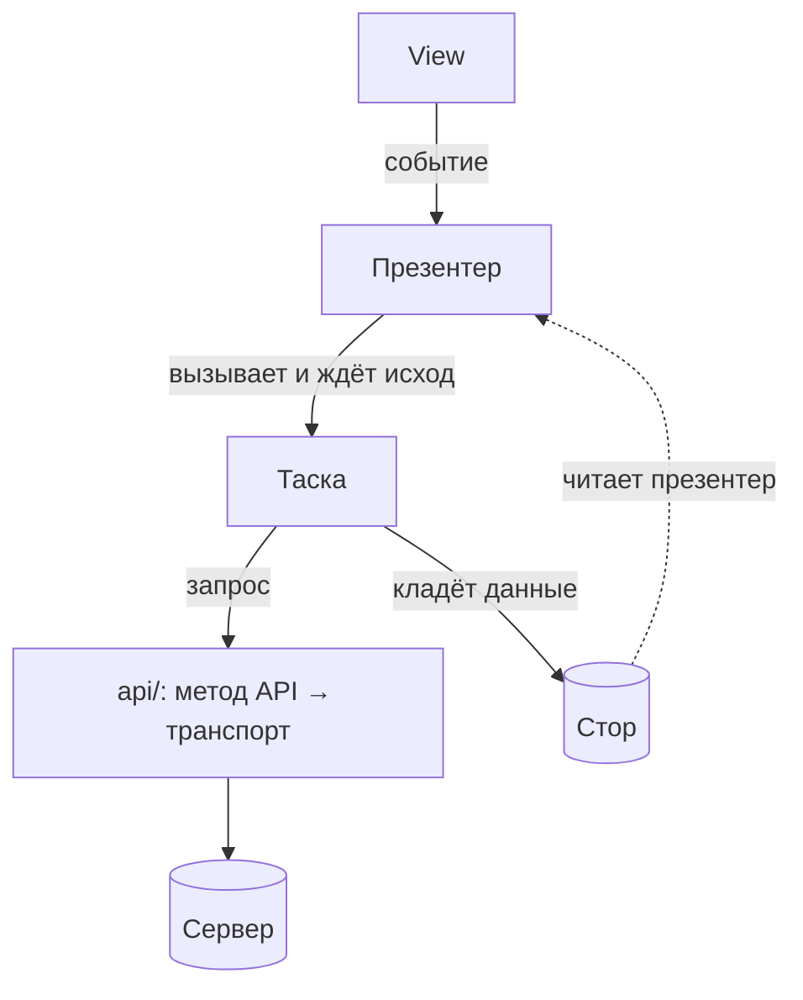

# Архитектурные правила

Верны для любого проекта: здесь нет его экранов, данных и библиотек. Чем правила исполнены в этом проекте — в `CLAUDE.md`, решения по фичам — в комментариях у кода, который их исполняет.

## Слои: кто кого вызывает



Цепочка одна, через звено не перепрыгивают: view не вызывает таску, презентер не ходит в `api/`, стор не ходит никуда. Обратно view получает от презентера готовые данные и действия.

| Слой | Файл | Его работа | Чего в нём нет |
| --- | --- | --- | --- |
| **View** | `<Name>.tsx` | Разметка | Хуков, кроме одного `usePresenter()`; логики; импортов тасок и `api/` |
| **Презентер** | `logic/usePresenter.ts` | Вызывает таски на события, читает стор, считает производные данные, держит состояние действия и интерфейса, ведёт среду | `fetch`, типов сервера, импортов из `api/` |
| **Таска** | `logic/tasks/<глагол>.ts` | Один вариант использования целиком: вызывает методы API, кладёт данные в стор, возвращает исход | React, `fetch`, формата ответа сервера, текстов, ошибок наружу |
| **Метод API** | `api/<entity>/<метод>.ts` | Один запрос: вызывает транспорт, возвращает данные с типом, ошибку бросает как `ApiError` с причиной | Ожидания, повторов, `AbortController`, записи в стор, текстов |
| **Транспорт** | `api/client.ts` | Как говорить с сервером: адрес, `fetch`, проверка ответа | Знания о том, что лежит в ответе |
| **Стор** | `stores/<name>/<name>.ts` | Хранит исходные данные приложения: поля и сеттеры | Логики; импортов тасок, `api/` и других сторов; производных данных; флагов загрузки |

- **Презентер и таска не знают друг о друге лишнего:** презентер — как устроены сеть и действие, таска — как устроен экран. *Почему:* таску можно вызвать с любого экрана и проверить без React.
- **Среда — дело презентера:** фокус, прокрутка, навигация, пауза во вводе. Большой кусок он выносит в хук рядом (`logic/use<Name>.ts`).
- **Состояние действия (`isLoading`, `error`) и интерфейса (открыто ли окно) — `useState` в презентере, а не стор.** *Почему:* это состояние одного запуска на одном экране; стор не обрастает флагами каждого запроса.
- **Стор — база данных: поля и сеттеры, один сеттер пишет одно поле** (`ordersStore.setList(list)`; никто не пишет `ordersStore.list = …`). Что и когда записать, решает таска, и работать она может с любыми сторами. *Почему:* действие на несколько сторов (выход из аккаунта чистит пользователя, корзину и уведомления) не принадлежит ни одному из них: в методе стора оно тянет импорт других сторов, и рано или поздно два стора импортируют друг друга.
- **Адреса и формат сервера не выходят за `api/`.** *Почему:* сменится сервер — правим только эту папку.

## View

```tsx
export function OrderList({ isLoading }: OrderListProps) {
  const p = usePresenter(isLoading)

  return (
    <ul>
      {p.orders.map((order) => (
        <li key={order.id}>
          <Button onClick={() => p.onSelect(order.id)}>{order.title}</Button>
        </li>
      ))}
      {p.isEmpty && <Text>{texts.orderList.empty}</Text>}
    </ul>
  )
}
```

- **В JSX можно:** `&&`, `? :`, `??`, `||`, `.map` и стрелку, которая передаёт элемент списка в колбэк. В ui-kit ещё стрелку, которая достаёт значение из события: `(e) => onChange(e.target.value)`.
- **Сравнения, форматирование и подсчёты делает презентер** и отдаёт готовое: `p.isEmpty`, а не `p.orders.length === 0`. *Почему:* view читается как разметка, логика куска собрана в одном файле рядом.
- **Компонент со своим презентером читает стор сам.** Через props ему приходит только то, чего в сторе нет: состояние действия и действия презентера-владельца; свой презентер получает их аргументами. Компонент без презентера получает всё через props. *Почему:* view экрана не пересылает данные стора транзитом.
- **Блок экрана, который сам решает, показываться ли ему, — компонент со своим презентером.**

## Исход таски

```ts
type CreateOrderOutcome = { status: 'success' } | { status: 'cancelled' } | { status: 'error'; error: ApiErrorKind }
```

- **Таска возвращает исход и не бросает ошибок; презентер ждёт её через `await`** и решает, что делать: показать ошибку, снять загрузку, уйти на другой экран. *Почему:* один и тот же вариант использования разные экраны показывают по-разному.
- **Таска без запроса к серверу ничего не возвращает** (очистить список, показать сообщение). *Почему:* ей не в чем ошибиться, а исход, который никто не читает, — шум.
- **Имя таски — глагол:** `createOrder` — «оформить заказ». Внутри её можно делить на части и вызывать другие таски, снаружи это один вызов.
- Временный вариант: устаревший запрос обрывает презентер. Он создаёт `AbortController` и передаёт `signal` в таску, та — в метод API. Кто должен обрывать, решим после ДЗ 2.

## Где что лежит

```
src/
  ui-kit/               атомы
  components/           компоненты, нужные двум и больше экранам
  screens/<name>/
    <Name>.tsx          view экрана
    logic/              usePresenter.ts, хуки use<Name>.ts, tasks/
    <Block>/            блок экрана: такая же папка со своими logic/ и детьми
    components/         компоненты, нужные нескольким блокам экрана
  tasks/, hooks/        таски и хуки, нужные двум и больше экранам
  stores/               глобальные сторы
  api/                  транспорт и методы API
  types/                свои типы: исходы тасок
  locales/              тексты интерфейса
  styles/               токены и сброс
```

- **Код лежит рядом с тем, кто его использует.** Нужен одному месту — лежит у владельца: компонент прямо в его папке, таска в его `logic/tasks/`, хук в его `logic/`. Понадобился второму — переносим в их ближайшую общую папку (`components/`, `logic/tasks/`, `logic/`). Нужен двум экранам — в `src/`. *Почему:* общий код появляется, только когда он правда нужен двоим.
- **Компонент и экран — папка:** `<Name>/<Name>.tsx` со стилями, рядом дети и `logic/`. `logic/` появляется с первым файлом логики; у экрана презентер есть всегда. *Почему:* всё, что относится к компоненту, переезжает вместе с папкой.
- **Импорт — только вверх по дереву:** свои дети и `components/` любой папки выше. В папку другого компонента за его детьми не лезем. *Почему:* по дереву видно, кто кого использует.
- **Своё дерево — относительным путём, общие слои `src/` — через алиас,** по одному на слой (`@ui-kit/`, `@stores/`, …). *Почему:* путь к слою не зависит от глубины папки и не ломается при переезде.

## ui-kit и стили

- **ui-kit — только атомы:** текст, кнопка, ссылка, поле ввода, картинка, иконка. Атом получает props и возвращает JSX: без хуков, без импортов из `ui-kit/` и других слоёв, без текстов и предметной области. *Почему:* атом ставится в любое место и в любое приложение.
- **Вид атома — его варианты** (`variant`, `size`, `tone`). Владелец не передаёт `className` и `style`, отступы задаёт своей обёрткой. *Почему:* одинаковые элементы выглядят одинаково, новый вид — осознанная правка атома.
- **Вне `ui-kit/` в JSX только теги раскладки:** `div`, `section`, `header`, `main`, `nav`, `article`, `ul`, `li` и `label` как обёртка поля. Остальное — через атомы. *Почему:* новая сборка не нарисует свой вариант мимо атома.
- **Стили лежат рядом с компонентом,** цвета и шрифты берутся из токенов. *Почему:* палитра меняется в одном файле.

## Типы, тексты, размер файла

- **Типы данных — отдельно от кода:** общие с сервером в `contract/`, свои (исходы тасок) в `src/types/`; там только `type` и `interface`. Типы props — в файле компонента. Типы чужого API не выходят за папку, которая с ним говорит.
- **Тексты интерфейса — в `src/locales/<язык>.ts`,** код берёт их через `texts` из `locales/index.ts`. Ключи сгруппированы по компоненту, текст с подстановкой — функция. Готовый текст view берёт сам; текст с подстановкой и по исходу таски выбирает презентер. Атомы получают тексты через props; таски, `api/` и сервер отдают причину ошибки, а не фразу. *Почему:* новый язык — перевод одного файла.
- **Файл кода — не больше 120 строк;** таска, которая не влезла, становится папкой `tasks/<name>/`. *Почему:* длиннее — сигнал, что пора делить.

## Свой сервер

- **Три папки: `src/` — сайт, `server/` — сервер, `contract/` — типы между ними.** Сайт не импортирует `server/`, сервер — `src/`. *Почему:* изменил поле ответа — сайт не соберётся, пока его не поправишь.
- **Та же цепочка: маршрут → таска → `api/` и сторы.** Маршрут (`routes/`) разбирает запрос, вызывает одну таску и по её исходу выбирает код ответа — как презентер. Таска (`tasks/`) не знает `req`, `res` и `fetch`. `api/<service>/` прячет формат чужого API. `stores/` — данные и функции к ним; напрямую данные не трогают. *Почему:* одни слова на сайте и на сервере, бизнес-логика не зависит от фреймворка.
